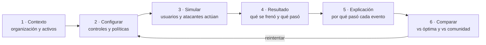
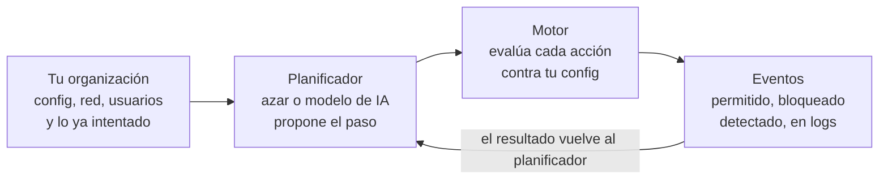
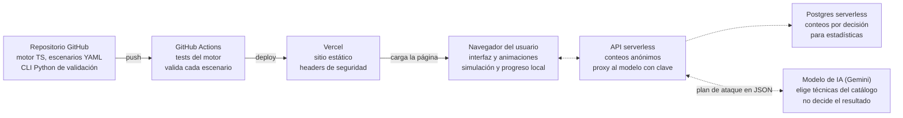

# SecOps Explorer — concepto del proyecto

Nov 8, 2026 · @Santi Flores

## La idea

SecOps Explorer es un sitio gratuito, en español primero, donde practicás seguridad defensiva configurando sistemas simulados y viendo al instante qué pasa cuando usuarios legítimos y atacantes chocan contra tu configuración.

De [Protocol Explorer](https://protocol-explorer-alpha.vercel.app/) toma lo que lo hace bueno: animaciones paso a paso, todo en el navegador, nada que instalar y varios idiomas. Lo que agrega es la decisión: ahí mirás cómo funciona un protocolo; acá tocás la configuración y la simulación te devuelve las consecuencias.

La lección de fondo de todo el sitio: la configuración óptima es la que frena al atacante sin romperle el trabajo al usuario legítimo. Bloquear todo nunca gana.

- **Público:** estudiantes de sistemas, gente preparando certificaciones como Security+, admins y analistas SOC junior de habla hispana.
- **Nombre de trabajo:** SecOps Explorer. Alternativas: Blue Team Explorer, Hardening Lab.

## El ciclo central

Cada ejercicio sigue el mismo ciclo de seis pasos, y el puntaje mide tres ejes a la vez para que la respuesta perezosa (cerrar todo) pierda.

**Cada intento cierra comparando tu configuración con la óptima.** El ciclo se repite hasta equilibrar seguridad y operatividad.



Configurar es el paso que se repite: la comparación final dice qué cambiar en el siguiente intento.

1. **Contexto:** una organización ficticia, sus activos y qué necesita para trabajar.
2. **Configurar:** ajustás controles reales: toggles, reglas, políticas o el texto de un archivo de configuración.
3. **Simular:** el motor reproduce una línea de tiempo con usuarios legítimos, bots y atacantes actuando contra tu configuración.
4. **Resultado:** cada evento se anima y queda marcado como permitido, bloqueado, detectado o no detectado.
5. **Explicación:** por qué pasó cada cosa, con la buena práctica que aplica y su fuente.
6. **Comparar:** tu configuración contra la óptima y contra lo que eligió la comunidad; después reintentás.

| Eje | Qué mide | Ejemplo de penalización |
| --- | --- | --- |
| Seguridad | ataques bloqueados o detectados | la credencial filtrada logró entrar |
| Operatividad | usuarios legítimos que pudieron trabajar | el admin que viaja quedó bloqueado |
| Costo operativo | complejidad de mantener la configuración | 40 reglas de firewall donde bastaban 6 |

Cada escenario define el peso de cada eje; el resultado muestra los tres por separado y una nota final.

## Tipos de ejercicio

Cuatro tipos de ejercicio cubren el trabajo defensivo real, de entender un ataque a responder un incidente; todos corren sobre el mismo motor de eventos.

| Tipo | Qué hace el usuario | Interfaz | Ejemplo |
| --- | --- | --- | --- |
| Entender | mira un ataque o un control animado paso a paso | línea de tiempo animada, al estilo Protocol Explorer | cómo un phishing termina en robo de sesión |
| Configurar | ajusta una configuración y la pone a prueba | panel de controles o editor de config + simulación | endurecer un servidor SSH expuesto |
| Detectar | lee logs, escribe reglas y clasifica alertas | visor de logs, editor de reglas, cola de alertas | una regla que detecte password spraying sin ahogar en ruido |
| Responder | decide bajo presión durante un incidente | árbol de decisiones con reloj simulado | ransomware en el file server un viernes a la noche |

Configurar es el núcleo de tu idea y del MVP. Entender sirve de introducción a cada track; Detectar y Responder llegan después reutilizando los mismos eventos.

## Catálogo de tracks

Diez tracks cubren los dominios de seguridad defensiva, y cada escenario lleva etiquetas de MITRE ATT&CK, NIST CSF 2.0 y objetivos de Security+, así sirve también como práctica de certificación.

| Track | Escenarios posibles | Tipo principal |
| --- | --- | --- |
| Red y perímetro | firewall stateful, segmentación con VLAN y DMZ, VPN con WireGuard, puertos expuestos | Configurar |
| Hardening de sistemas | SSH, sudo y permisos en Linux, servicios innecesarios, políticas de Windows | Configurar |
| Identidad y acceso | MFA, políticas de contraseña, mínimo privilegio, RBAC, cuentas de servicio | Configurar |
| Web y AppSec | OWASP Top 10, headers (CSP, HSTS), cookies, CORS, rate limiting, reglas de WAF | Configurar y Entender |
| Criptografía y PKI | versiones y suites de TLS, forward secrecy, cadena de certificados, hashing de contraseñas, rotación de claves | Configurar y Entender |
| Correo | SPF, DKIM, DMARC, suplantación y phishing | Configurar |
| Cloud | buckets públicos, security groups, políticas IAM en JSON, logging | Configurar |
| DevSecOps | secretos en repos, SAST, dependencias vulnerables, protección de ramas, ataque a la cadena de suministro | Configurar |
| SOC y detección | lectura de logs, reglas de SIEM e IDS, triage de alertas | Detectar |
| Respuesta a incidentes | ransomware, cuenta comprometida, fuga de datos, siguiendo las fases de NIST SP 800-61 | Responder |

Más adelante, un track de OT e infraestructura crítica (Modbus, segmentación industrial) conecta con el foco en ciberdefensa. Criptografía se presta especialmente a lo visual: un handshake TLS o un ataque de downgrade animados enseñan más que una tabla de suites.

## Tres escenarios de ejemplo

Estos tres escenarios muestran el ciclo completo y pueden ser el primer lote del MVP: dos de Configurar y uno de Detectar.

### 1. El SSH expuesto · Configurar · Hardening

- **Contexto:** una cooperativa ficticia tiene un servidor Linux con SSH abierto a internet; tres admins entran desde sus casas.
- **Controles:** PermitRootLogin, PasswordAuthentication, autenticación por clave, puerto, AllowUsers, fail2ban (intentos y tiempo de bloqueo), MFA, acceso solo por VPN.
- **Actores:** tres admins legítimos (uno de viaje, con IP cambiante), una botnet de fuerza bruta desde cientos de IPs y un atacante con la contraseña filtrada de un admin.
- **Lección:** desactivar contraseñas frena a la botnet y a la credencial filtrada; un fail2ban demasiado agresivo deja afuera al admin que viaja.

### 2. El dominio que suplantan · Configurar · Correo

- **Contexto:** llegan mails falsos del "gerente" pidiendo transferencias; marketing manda newsletters desde un proveedor externo.
- **Controles:** registro SPF (con o sin el proveedor), firma DKIM, política DMARC (none, quarantine, reject) y destino de reportes.
- **Actores:** empleados que mandan mail normal, el newsletter del proveedor y un estafador que suplanta al gerente.
- **Lección:** DMARC en reject sin autorizar al proveedor rechaza el newsletter legítimo; el camino óptimo es none, quarantine y reject, mirando los reportes en cada paso.

### 3. La mañana del analista · Detectar · SOC

- **Contexto:** turno de SOC con 40 alertas en 15 minutos simulados.
- **Tareas:** clasificar cada alerta (verdadero positivo, falso positivo, escalar) y escribir una regla que detecte password spraying.
- **Métricas:** precisión y cobertura de la regla, falsos positivos generados, tiempo medio de detección.
- **Lección:** una regla muy amplia ahoga al analista en ruido; una muy estrecha deja pasar el ataque.

## Lo que hacen los usuarios

"Basado en lo que hacen los usuarios" entra por dos lados: usuarios simulados dentro de cada escenario y datos reales de la comunidad que juega.

- **Usuarios simulados con comportamiento:** cada escenario trae perfiles (el admin que viaja, la contadora que hace clic en todo, el dev que sube secretos al repo). La configuración se evalúa contra lo que ellos hacen, no contra un checklist.
- **Estadísticas de la comunidad:** al terminar, ves qué porcentaje de jugadores eligió cada opción en cada decisión. Muestra los errores más comunes y le da contexto a tu resultado.
- **Errores frecuentes como contenido:** las decisiones que más gente falla se convierten en mini-lecciones y en pistas.
- **Escenarios aportados:** cada escenario es un archivo YAML en el repo; cualquiera propone uno por pull request y pasa por revisión.
- **Compartir resultados:** la configuración y la semilla van en la URL, así un link reproduce tu partida exacta sin necesidad de backend.
- **Privacidad:** solo conteos agregados y anónimos; sin cuentas ni datos personales en el MVP.

## Adversario con IA y tu propia organización

Dos agregados convierten el sitio de un curso en un campo de práctica: ataques que cambian en cada partida y, al avanzar, una organización propia que diseñás y defendés.

### Ataques impredecibles, en dos capas

- **Capa 1, azar con semilla (sin IA):** el motor arma cadenas de ataque al azar desde un catálogo de técnicas MITRE ATT&CK con prerrequisitos (moverse lateralmente exige una credencial; exfiltrar exige acceso a datos). Cambian el orden, los tiempos, los orígenes y los objetivos. Es gratis, instantáneo y reproducible.
- **Capa 2, adversario con IA (Gemini u otro modelo):** el modelo recibe tu configuración resumida y lo que ya intentó, y devuelve el próximo paso en JSON, elegido del mismo catálogo. Se adapta: si cerraste SSH, pivotea a phishing; si no hay MFA, prueba credenciales robadas. También escribe la parte narrativa: el mail de phishing de la partida, el ticket del usuario que no puede entrar, el informe final con tus errores.
- **Regla de oro: el modelo propone, el motor decide.** El resultado de cada acción lo calcula siempre el motor determinístico. Así el puntaje es justo y el modelo nunca puede inventar que un ataque funcionó.

**El planificador propone el próximo paso; el motor decide si funciona.**



Cambiar el azar por la IA solo reemplaza la caja del planificador; el motor y el puntaje quedan iguales.

| Modo | De dónde salen los ataques | Resultados comparables | Requiere IA |
| --- | --- | --- | --- |
| Práctica | escenario fijo | sí, entre todos | no |
| Aleatorio | capa 1, semilla visible | sí, con la misma semilla | no |
| Caos | capa 2, adversario adaptativo | no, cada partida es única | sí |

Para operarlo en un sitio público:

- **La clave nunca llega al navegador:** el navegador llama a una función serverless en Vercel, que guarda la clave como variable de entorno y habla con el modelo.
- **Límites de uso:** rate limit por IP y cupo diario global; una IA abierta al público sin límites es una factura abierta. Antes de lanzar, revisar los límites del plan gratuito de Gemini y qué hace Google con esos datos.
- **Opción "traé tu clave":** quien quiera jugar más pega su propia clave, que queda solo en su navegador.
- **Sin IA el juego sigue:** si el modelo falla o se acaba el cupo, la partida continúa con la capa 1.
- **Proveedor intercambiable:** una interfaz única (`AdversaryPlanner`) con adaptadores para Gemini, otros modelos o uno local con Ollama para desarrollar sin gastar.

### Tu organización: el modo sandbox

- **Se desbloquea jugando:** cada escenario superado suma piezas. Terminás el de DMARC y aparece el servidor de correo con sus controles; terminás el de SSH y podés endurecer servidores Linux.
- **Lienzo al estilo Packet Tracer:** arrastrás routers, switches, firewalls, servidores, estaciones, servicios cloud y usuarios; definís zonas, VLANs, reglas entre zonas, servicios expuestos e identidades.
- **Presupuesto:** cada control cuesta, así el eje de costo operativo se vuelve plata concreta y obliga a priorizar.
- **Prueba de fuego:** el motor calcula un grafo de ataque (qué se alcanza desde internet, con qué credenciales, hacia dónde se puede mover un atacante) y el adversario, con azar o con IA, elige el camino. Mientras tanto, los usuarios simulados trabajan y reclaman si algo no les anda.
- **Cierre del círculo:** tu organización genera logs y alertas, y la defendés desde la vista SOC: Detectar y Responder sobre tu propia red.
- **Guardado:** en el navegador, con exportar e importar en JSON y compartir por link.

Nivel de abstracción: Packet Tracer emula dispositivos con su CLI y enrutamiento real, y copiar eso es un proyecto de años. Acá el modelo es lógico (zonas, alcanzabilidad, servicios, identidades y políticas) y los paquetes se animan para mostrar un flujo, no se emulan. Es el nivel justo para aprender decisiones de arquitectura de seguridad.

## Arquitectura y despliegue en Vercel

Todo corre en el navegador: el motor es TypeScript determinístico y los escenarios son datos, así que el sitio se despliega en Vercel como sitio estático, sin servidores que atacar ni máquinas virtuales que pagar.

**El motor corre en el navegador; el modelo solo propone el ataque.** Punteado: fases 2 y 4 · la clave del modelo nunca llega al navegador.



En el MVP solo existen la fila de arriba y el navegador; la API y la base llegan con las estadísticas de la comunidad, y el modelo con el modo caos.

| Pieza | Elección | Por qué |
| --- | --- | --- |
| Framework | Next.js con TypeScript | despliegue nativo en Vercel, una ruta por escenario, i18n |
| Motor de simulación | librería TS propia con semilla aleatoria fija | misma config y misma semilla dan el mismo resultado; se testea fácil |
| Escenarios | archivos YAML validados con Zod | el contenido vive separado del código y entra por pull request |
| Visualización | SVG con Framer Motion; React Flow para topologías y el editor de tu organización | animar paquetes y eventos como Protocol Explorer |
| Editor de configs y reglas | CodeMirror | resaltado de sintaxis para sshd\_config, reglas y políticas |
| Progreso | localStorage | sin cuentas ni datos personales en el MVP |
| Estadísticas (fase 2) | función serverless + Postgres serverless (Neon o Supabase) | solo conteos agregados por decisión |
| Adversario con IA (fase 4) | función serverless que llama a Gemini y pide salida en JSON, validada con Zod | la clave queda en el servidor y el motor rechaza toda técnica fuera del catálogo |
| Herramientas | CLI en Python que valida escenarios y genera logs sintéticos | aprovecha tu Python; corre en GitHub Actions |

Un escenario, en su forma más simple:

```yaml
id: ssh-expuesto
track: hardening
tipo: configurar
tags: { attack: [T1110], csf: [PR.AA] }
controles:
  - { id: password_auth, tipo: toggle, default: true }
  - { id: fail2ban_maxretry, tipo: numero, rango: [0, 20], default: 0 }
actores:
  - { id: admin_viajero, rol: legitimo, accion: login_clave, ip: variable }
  - { id: botnet, rol: atacante, accion: login_password, ip: pool_grande }
evaluacion:
  - si: { accion: login_password, password_auth: false }
    resultado: bloqueado
    explicacion: password_auth_off
pesos: { seguridad: 0.5, operatividad: 0.35, costo: 0.15 }
```

El motor recorre la línea de tiempo, evalúa cada acción contra la configuración y devuelve una lista de eventos con su resultado; la interfaz solo anima esa lista. Esa separación permite testear el motor sin interfaz y sumar tipos de ejercicio sin reescribirlo.

## Contenido seguro y ético

Al ser público, el sitio enseña defensa y muestra ataques solo dentro de la simulación, sin nada que funcione contra sistemas reales.

- **Sin exploits ni payloads funcionales:** los ataques son eventos y animaciones, nunca código ejecutable.
- **Direcciones y dominios reservados:** IPs de 192.0.2.0/24, 198.51.100.0/24 y 203.0.113.0/24 (RFC 5737) y dominios como example.com o .test (RFC 2606).
- **Nada sale del navegador:** sin escaneos ni conexiones a terceros desde la simulación.
- **Organizaciones ficticias:** nunca empresas ni marcas reales; los incidentes reales aparecen solo como casos de estudio citados.
- **IA acotada:** el modelo solo elige técnicas del catálogo y escribe textos de la ficción, marcados como simulación. Su salida se valida contra un esquema y lo que escribe el jugador nunca le llega como instrucción, para cortar intentos de prompt injection.
- **Buenas prácticas citadas, con palabras propias:** NIST, OWASP, la guía TLS de Mozilla, CIS Benchmarks. Los CIS tienen licencia propia: se referencian, no se copian.
- **El sitio predica con el ejemplo:** CSP estricta, HSTS, sin trackers y dependencias auditadas en CI. Hasta puede ser un escenario: "auditá este mismo sitio".

## Diferenciación

Las plataformas conocidas (TryHackMe, Hack The Box, LetsDefend, Blue Team Labs Online, CyberDefenders) se apoyan en máquinas o laboratorios reales; este proyecto ocupa el hueco de la simulación instantánea, explicada y en español.

| Aspecto | Labs con máquinas reales | SecOps Explorer |
| --- | --- | --- |
| Arranque | levantar una máquina, minutos | inmediato, en el navegador |
| Foco | atacar o investigar sistemas reales | entender por qué una configuración es la correcta |
| Adversario | escenarios preparados de antemano | aleatorio o adaptativo según tu configuración |
| Tu propia red | no suele ser el foco | modo sandbox para diseñar y defender tu organización |
| Feedback | flag encontrada o no | tres ejes y una explicación por evento |
| Idioma | mayormente inglés | español primero |
| Profundidad técnica | alta, con herramientas reales | conceptual y operativa |

No compite con esos labs: los complementa. Entendés acá y practicás con herramientas reales allá, o en tu propio laboratorio con Wazuh y Suricata como siguiente paso de cada track.

## Roadmap y MVP

El MVP sale con un solo tipo de ejercicio (Configurar) y tres escenarios, publicado en Vercel; todo lo demás se suma sobre el mismo motor, y cada fase cierra con un criterio verificable.

**El MVP sale chico; la IA y tu organización llegan con el motor ya probado.**

| Fase | Nombre | Alcance | Criterio para pasar a la siguiente |
| --- | --- | --- | --- |
| Fase 0 | Prueba | motor mínimo, escenario SSH, deploy en Vercel | La idea funciona: alguien externo lo juega sin ayuda |
| Fase 1 | MVP | SSH, DMARC, web; puntaje 3 ejes; compartir por URL | Lanzamiento: 3 escenarios listos, tests en CI |
| Fase 2 | Comunidad | stats anónimas; escenarios por PR; primeros Detectar | Comunidad activa: primer escenario aportado por otro |
| Fase 3 | Profundidad | SOC y Respuesta; catálogo MITRE; ataques al azar | Motor robusto: partidas al azar sin errores en CI |
| Fase 4 | Organización | editor de red; adversario con IA; modo caos | — |

No se pasa de fase por fecha sino por criterio: los rombos marcan qué tiene que ser cierto para avanzar.

Checklist del MVP:

- [ ] Repo en GitHub y proyecto Next.js desplegado en Vercel
- [ ] Motor: modelo de escenario, actores, evaluación y semilla fija
- [ ] Esquema YAML con validación
- [ ] Escenario SSH expuesto
- [ ] Escenario DMARC
- [ ] Escenario de headers de seguridad web
- [ ] Pantalla de resultado con tres ejes y explicación por evento
- [ ] Compartir partida por URL
- [ ] Tests del motor corriendo en GitHub Actions
- [ ] Headers de seguridad del propio sitio (CSP, HSTS)

## Decisiones abiertas

- [ ] Nombre definitivo y dominio.
- [ ] Universo narrativo: ¿una organización ficticia recurrente (por ejemplo CoopSur, la de tu roadmap de ciberdefensa) o una distinta por escenario?
- [ ] ¿Código abierto desde el día uno (suma para portfolio y contribuciones) o recién después del MVP?
- [ ] Motor en TypeScript, que es lo natural en el navegador, con Python solo para herramientas y generación de datos: ¿te cierra?
- [ ] ¿Cuentas de usuario alguna vez, o solo progreso local más estadísticas anónimas?
- [ ] ¿Inglés desde el MVP o solo español al principio?
- [ ] ¿La configuración óptima se muestra siempre, o recién después de dos intentos?
- [ ] Modelo de IA: ¿cupo diario pagado por el sitio, solo "traé tu clave", o las dos cosas?
- [ ] ¿Gemini como único proveedor al principio, o el adaptador abierto desde el día uno?
- [ ] ¿Qué desbloquea el modo sandbox: completar todos los tracks, o cada escenario suma piezas sueltas?
